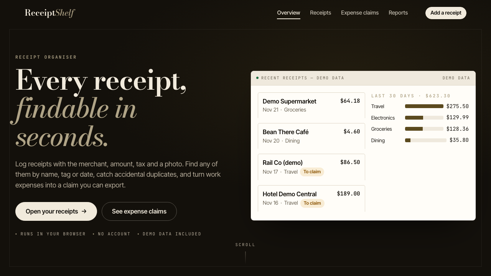
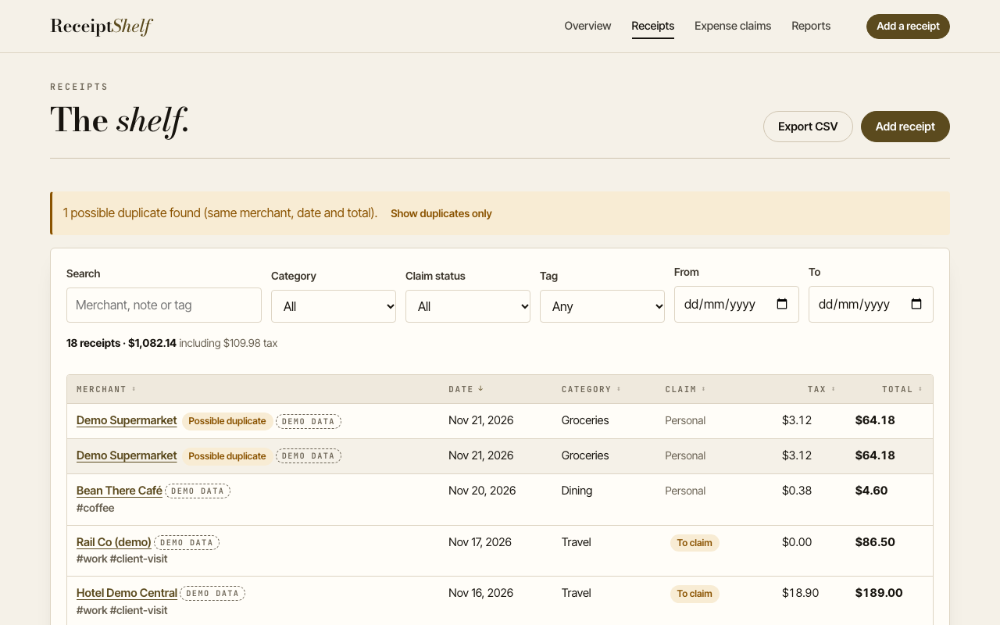
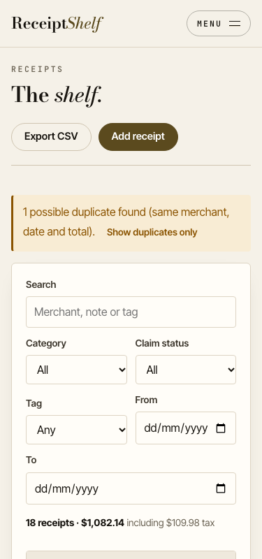

# Receipt Shelf

A receipt organiser: log merchant, date, total, tax, category and tags, attach a photo (resized in the browser), catch accidental duplicates, move work expenses through a claim pipeline, and see where the money went.

**Live demo:** [https://receipt-shelf.vercel.app/](https://receipt-shelf.vercel.app/) — runs entirely in your browser; demo data is fictional and labelled.



| Receipts | Mobile |
| --- | --- |
|  |  |

## Run it

```bash
npm install
npm run dev        # http://localhost:5209
npm test
npm run build
npm run test:e2e   # Playwright smoke test (npm run e2e:install once if Chromium is missing)
```

## Main workflow

1. The app opens with eighteen labelled **demo receipts** over four months, including work expenses at each claim stage, a very long merchant name and one receipt entered twice. **Receipts → Clear demo receipts** removes them.
2. **Add receipt** → merchant, date, total, tax, category, payment method, tags, claim status and a note. **Attach a photo** downscales it to 720 px JPEG in the browser. Saving a likely duplicate asks for confirmation first.
3. **Receipts** → search, filter by category, claim status, tag and date range; totals for what’s shown; sortable, paginated table; CSV export; “show duplicates only”.
4. **Expense claims** → three columns (to claim, claimed, reimbursed) with totals, a CSV per stage including a total row, and one-click “mark claimed / reimbursed”.
5. **Reports** → spending per month for six months (axis, legend, details on hover or focus) and a category table with share bars.

## Rules

- A **possible duplicate** has the same merchant (ignoring case and spaces), date and total.
- Dates can’t be in the future; tax can’t exceed the total. Amounts are rounded to cents.
- Tags are lower-cased, spaces become hyphens, duplicates are dropped (max 8).
- Photos are refused if they aren’t images or are over 15 MB; saving is refused if the store would exceed about 4 MB, so local storage never silently fails.

## Design

Shared editorial system: Bodoni Moda display type, Inter Tight interface text, mono amounts, receipt “stubs” with a torn edge in the hero, claim stages colour-coded (amber, accent, green), and a warm paper workspace. Motion is disabled under `prefers-reduced-motion`.

## Tests

- `src/lib/receipts.test.ts` — tag parsing, validation, duplicate matching and grouping, filters, totals by category and month, claim summary and progression, CSV rows.
- `src/App.test.tsx` — list totals and duplicate filter, tag + claim filters, duplicate confirmation on save, claim pipeline, empty state and reports.
- `e2e/smoke.spec.ts` — landing, add a receipt with a photo, reload persistence, move claims, reports, plus 375px layout checks.

## Limitations

- No text recognition — amounts are typed in.
- Browser storage limits how many photos fit (roughly a few hundred small images).
- One currency (US dollar formatting). Not tax or accounting advice.

## Future improvements

- Store photos in IndexedDB for more space; multi-currency with conversion notes.

## Licence

MIT — see [LICENSE](LICENSE).
